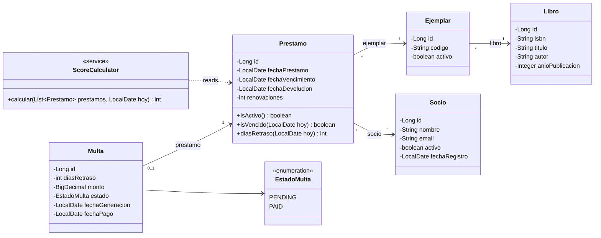

# Class diagram (JPA entities)

The domain model in Java: the `@Entity` classes, one enum and the service that derives the score. Names are Spanish where they come from the domain.

## Design notes

- **Associations only from the "many" side.** `Prestamo` points to `Ejemplar` and `Socio` with `@ManyToOne(fetch = LAZY)`, but `Socio` has no list of loans. This avoids loading huge collections by accident; histories are read through paginated repository queries.
- **Derived, not stored.** The score lives in `ScoreCalculator`, which reads loans and applies the formula in the [business rules](../business-rules.md). Availability and alerts are calculated the same way.
- **`Prestamo` helper methods** take today's date as an argument, so tests can move time with an injected `java.time.Clock` instead of waiting.
- **Booleans.** `activo` is `boolean` in Java and `NUMBER(1)` in Oracle, which has no boolean column type in tables. JPA converts between them.
- **Dates** are `LocalDate`, all interpreted in the `America/Lima` zone. Money is `BigDecimal`.

The matching relational model is in the [ER diagram](er-diagram.md).
