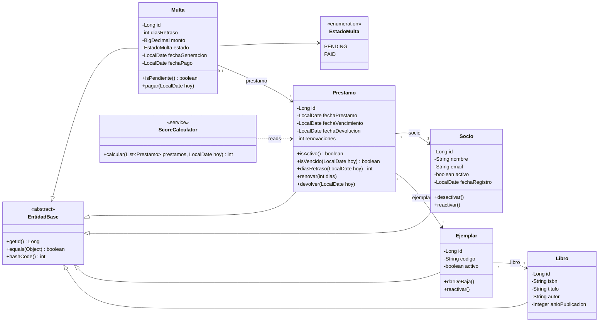

# Class diagram (JPA entities)

The domain model in Java: the `@Entity` classes, one enum and the service that derives the score. Names are Spanish where they come from the domain.

`ScoreCalculator` is not written yet; it arrives with the services.

## Design notes

- **Associations only from the "many" side.** `Prestamo` points to `Ejemplar` and `Socio` with `@ManyToOne(fetch = LAZY)`, but `Socio` has no list of loans. This avoids loading huge collections by accident; histories are read through paginated repository queries.
- **Derived, not stored.** The score lives in `ScoreCalculator`, which reads loans and applies the formula in the [business rules](../business-rules.md). Availability and alerts are calculated the same way.
- **Date methods take today as an argument**, so tests can move time with an injected `java.time.Clock` instead of waiting. Due day itself is on time.
- **State changes go through methods** (`renovar`, `devolver`, `pagar`, `darDeBaja`). Setters exist only for plain data. The business limits (3 renewals, 5 loans) are checked by the service and, as a last resort, by the schema.
- **Identity-based equality** in `EntidadBase`: same class and same non-null id, with a constant hash code so the value does not change when the id is assigned on save. It uses `Hibernate.getClass`, so lazy proxies compare equal to the real entity.
- **Lombok** removes the boilerplate: `@Getter`, `@Setter` (not on the id), a protected no-args constructor for JPA, and `@Builder` on the constructor. `@Data` is deliberately not used on entities, because its `equals`, `hashCode` and `toString` would load lazy associations.
- **Booleans.** `activo` is `boolean` in Java and `NUMBER(1)` in Oracle, which has no boolean column type in tables. JPA converts between them.
- **Dates** are `LocalDate` mapped to Oracle `DATE`, interpreted in the `America/Lima` zone. Money is `BigDecimal`.

The matching relational model is in the [ER diagram](er-diagram.md).
