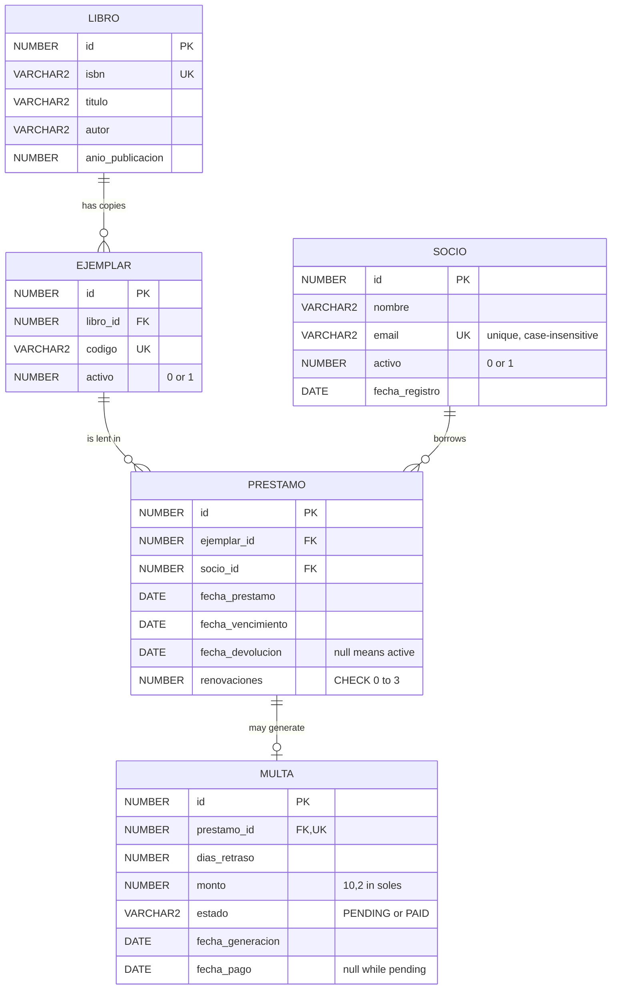

# Entity-relationship diagram (Oracle)

The relational model that Flyway migration `V1` will create. Table and column names stay in Spanish (the domain language); everything else is English.

## What the diagram does not draw

| Object | Purpose |
|--------|---------|
| Unique function-based index on `prestamo` over `CASE WHEN fecha_devolucion IS NULL THEN ejemplar_id END` | At most one active loan per copy |
| Unique index on `LOWER(socio.email)` | Case-insensitive unique email |
| `CHECK (renovaciones BETWEEN 0 AND 3)` | Renewal counter stays in range |
| `CHECK (fecha_vencimiento >= fecha_prestamo)` and `CHECK (fecha_devolucion >= fecha_prestamo)` | Coherent dates |
| `CHECK (estado IN ('PENDING','PAID'))` on `multa` | Valid fine status |
| Index on `ejemplar(libro_id)` and on `prestamo(socio_id)` | Oracle does not index foreign keys by itself; these serve joins and the active-loans lookup |

## What is deliberately not stored

- **Score**: derived from loan history at query time.
- **Copy availability**: a copy is available when it has no active loan.
- **Alerts** (`DUE_SOON`, `OVERDUE`, `PENDING_FINE`, `LOW_SCORE`): calculated on every query.

See [business rules](../business-rules.md) for the reasoning behind each choice.
