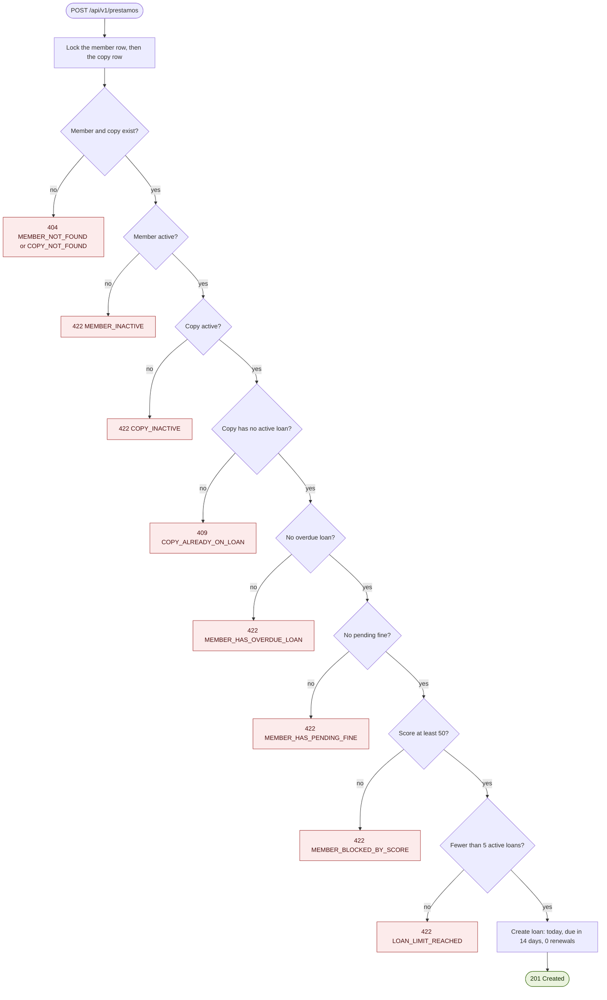
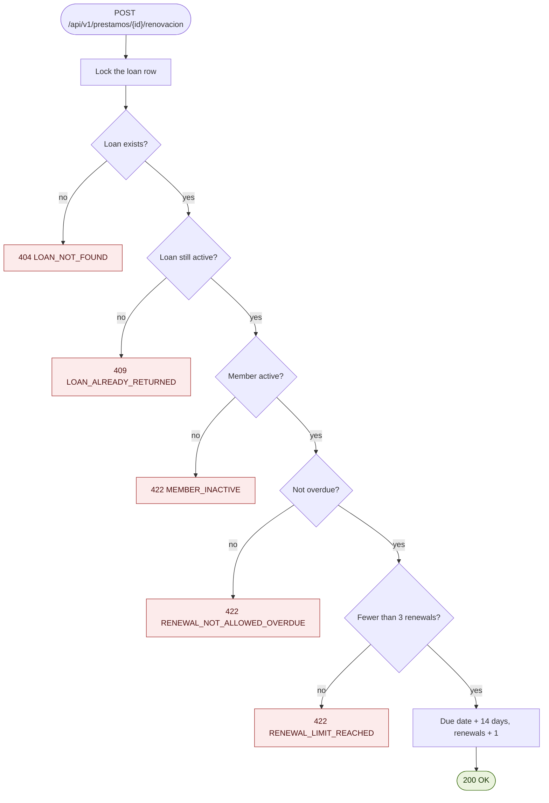
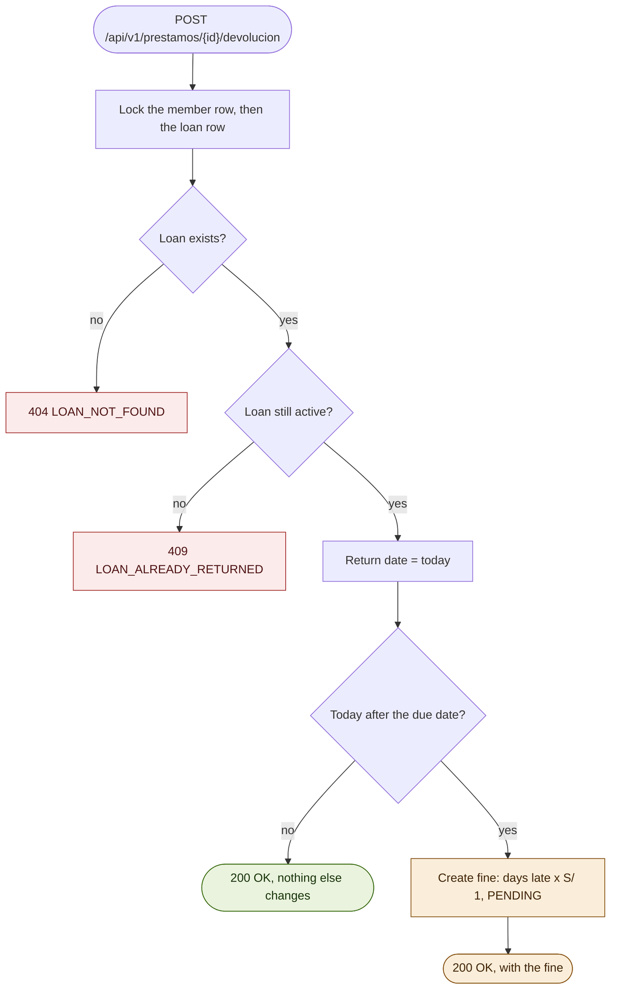

# Process flows

The three write operations as flowcharts. Each diamond is a check; a failed check stops the process and returns the HTTP status and error code shown in red. The checks run in the order drawn, so the same situation always gives the same error. Codes and statuses come from the [error catalog](../business-rules.md#14-error-catalog).

## 1. Create a loan

- The member row stays locked until the transaction commits, so two simultaneous loans for one member cannot pass the limit of 5.
- The copy row is locked too, so two simultaneous requests for the same copy are processed one after the other and the second one fails check 4. The unique index is the last safety net and gives the same `409 COPY_ALREADY_ON_LOAN`.

## 2. Renew a loan

- The 14 days are added to the **current due date**, not to today.
- A renewal never creates a new loan. A pending fine or a low score does not block it; they only block new loans.

## 3. Return a loan

- A return is always accepted for an active loan, even if the member or the copy is inactive.
- The score is never stored. A late loan lowers it by 10 plus one point per day late, calculated from history on every query. Paying the fine does not give points back.

See the [sequence diagrams](sequence-diagrams.md) for how each process travels through the layers.
