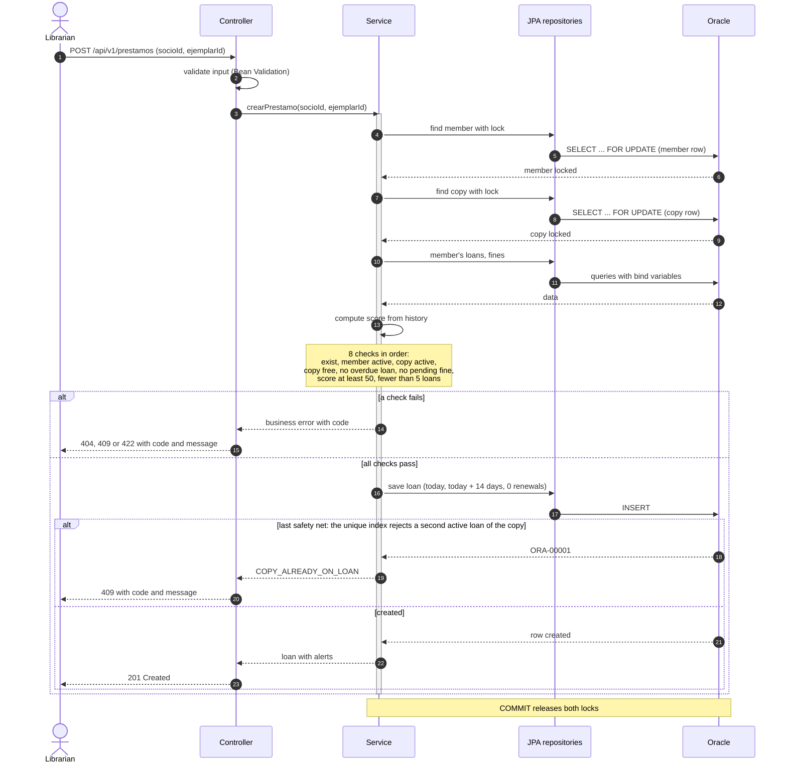
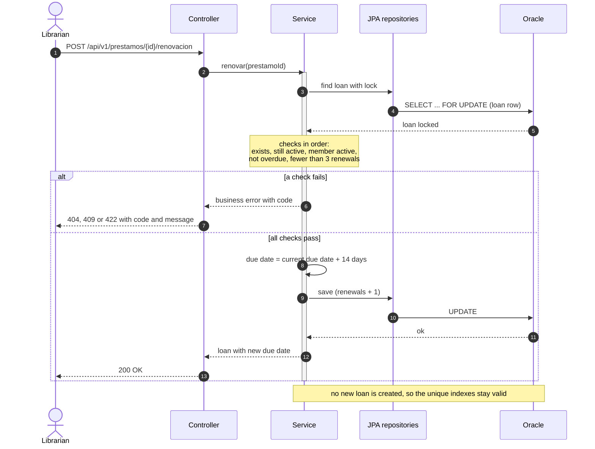
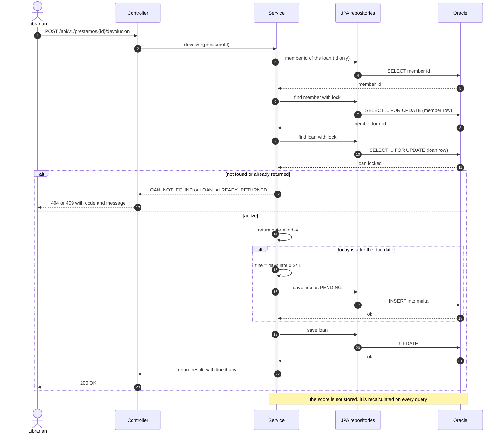

# Sequence diagrams

How a request travels from the librarian to Oracle in the three write operations. `alt` blocks mark the choice: the first branch is the error path, the last one the success path.

Participants: the librarian (client), the REST **Controller**, the **Service** that holds the business rules and the transaction, the Spring Data **JPA repositories**, and **Oracle**.

## 1. Create a loan

- The member row is locked **before** the checks, so two simultaneous loans for the same member are processed one at a time and cannot exceed the limit of 5.
- The copy row is locked right after, so when two librarians lend the same copy at once the second one waits, then sees the active loan and gets `409 COPY_ALREADY_ON_LOAN` from the normal check. The same lock stops a copy from being retired while it is being lent.
- The unique function-based index stays as the last safety net: if it ever fires, the handler translates `ORA-00001` to the same `409 COPY_ALREADY_ON_LOAN`.
- Locks are always taken in the same order (member, copy, loan) and each wait is capped at 5 seconds; if it runs out the answer is `409 CONCURRENT_UPDATE`.

## 2. Renew a loan

## 3. Return a loan

- Only the member id is read before locking, not the loan. Loading the loan first would leave a copy in memory that the later lock does not refresh, and the return could act on stale data.
- The member lock is defensive. With the current order of checks a loan being created cannot slip past the fine that a return is creating even without it (tests that removed it still passed), but the lock keeps that rule from depending on the order of two checks. It also makes two returns of the same member's loans go one after the other.

The error codes and their HTTP status are listed in the [error catalog](../business-rules.md#14-error-catalog).
